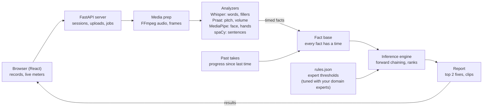

# Podium Backend Guide

Oct 29, 2026 · @Madhu

How Podium turns a rehearsal into coaching: what each backend piece does, which libraries to use, and the order to build it.

## Architecture at a glance

**Every analyzer writes timed facts; the rule engine turns them into the report.**



The browser records, the server prepares the media, and four analyzers run in parallel. Each analyzer only writes timed facts; the inference engine, driven by the expert rules in `rules.json`, is the one place that decides what feedback to give. Live mode adds one more loop on top (speech to text, Oli's reply, text to speech), covered below.

## Capture and upload

The browser records the user, and the backend only ever sees media plus a little setup info. There are two modes, and they need different plumbing.

**Record mode** (presentation, speech): the simplest path, and the one to build first.

1. The React app asks for camera and mic with `navigator.mediaDevices.getUserMedia({ video: true, audio: true })`.
2. `MediaRecorder` records to WebM (Chrome, Firefox) or MP4 (Safari) in 1 second chunks.
3. When the user stops, the chunks become one Blob, uploaded with `POST /sessions/{id}/upload` as multipart form data.
4. The server saves it to `storage/sessions/{id}/raw.webm` and queues an analysis job.

**Live mode** (interview, pitch, debate): Oli has to hear you while you talk, so audio streams instead of uploading at the end.

- Open a WebSocket to `/sessions/{id}/live`.
- Send small audio chunks (about 250 ms each) as you speak. The server transcribes them in near real time so Oli knows when you finished an answer.
- Keep recording the full video locally with MediaRecorder too, and upload it when the session ends. The deep analysis (body language, full voice metrics) runs on that complete file, same as record mode.

**Setup info sent with every session:** occasion, time limit, audience, the free text description, and any uploaded files (resume, job post, slides, script). Files go to `POST /sessions/{id}/files`; the server extracts their text with pypdf for PDFs, python-docx for Word, and python-pptx for slides.

## Transcription

Transcription turns speech into text with a timestamp on every word. Those timestamps are what let every other analyzer line up with the words.

**Tool:** OpenAI Whisper, run locally through faster-whisper (about 4x faster than the original, and it runs on a laptop CPU). Use the `small.en` model for development and `medium.en` if accuracy matters more than speed. Set `PODIUM_WHISPER_BACKEND=openai` to use the OpenAI Whisper API instead (no local model, about $0.006 per minute). Live mode uses the Whisper API to transcribe each answer as soon as you finish it.

```python
from faster_whisper import WhisperModel
model = WhisperModel("small.en", compute_type="int8")
segments, info = model.transcribe("audio.wav", word_timestamps=True,
                                  initial_prompt="Um, uh, like, you know, so, basically.")
words = [{"text": w.word.strip(), "start": w.start, "end": w.end, "conf": w.probability}
         for s in segments for w in s.words]
```

> **Gotcha:** Whisper silently cleans up fillers (it writes "I think" when you said "um, I think"). The `initial_prompt` full of fillers above nudges it to keep them. Test this early, because filler counting depends on it.

What you compute from the words:

| Metric | How | Feeds rule |
| --- | --- | --- |
| Pace (words per minute) | Word count divided by speaking minutes; also a rolling 15 second window to show pace over time | 1, 2, 15 |
| Filler rate | Match words against a filler list (um, uh, like, you know, so, basically, actually, kind of); count per minute | 3, 12, 15 |
| Pauses | Gap between one word's end and the next word's start; anything over 0.6 s is a pause | 4, 5 |
| Mid sentence vs intentional pause | Use spaCy sentence splitting: a pause inside a sentence is "lost place," a pause right before a sentence that follows a key phrase is "emphasis" | 4, 5 |
| Clarity | Average word probability from Whisper; low confidence usually means mumbling | 8 |
| Hedges, apologies, call to action | Phrase lists ("I think maybe", "sorry", "I'm not sure", "we're asking for", "sign up") checked with spaCy's PhraseMatcher | 12, 14, debate hedging |
| Answer length | Time from Oli finishing a question to the user's last word | 13 |

Every metric is saved as a fact with a start and end time (see the inference engine section), not just a number.

## Voice analysis

Voice analysis measures how you said it, separate from the words. First extract mono 16 kHz audio with FFmpeg: `ffmpeg -i raw.webm -ac 1 -ar 16000 audio.wav`.

| What | Library and method | Turned into |
| --- | --- | --- |
| Pitch (how high or low your voice is) | parselmouth (Praat in Python): `snd.to_pitch()` gives pitch in Hz every 10 ms | Pitch range and standard deviation; under 20 Hz of variation reads as monotone (rule 6) |
| Volume | `librosa.feature.rms` turned into decibels | Average loudness, plus the drop over the last 0.5 s of each sentence to catch trailing off (rule 7) |
| Voice activity | webrtcvad or silero-vad | Which stretches are speech vs silence; makes pause detection more accurate than word gaps alone |
| Energy over time | RMS plus pitch smoothed per 5 seconds | The "energy" line on the report chart; low energy plus slow pace in a pitch is worth flagging |

```python
import parselmouth, numpy as np
snd = parselmouth.Sound("audio.wav")
pitch = snd.to_pitch(time_step=0.01)
f0 = pitch.selected_array["frequency"]
f0 = f0[f0 > 0]                     # drop unvoiced frames
pitch_sd = float(np.std(f0))        # monotone if under about 20 Hz
```

Keep raw thresholds in the knowledge base, not in code, because men and women have different typical pitch ranges. A better version later: compare each person to their own baseline from their first session instead of a fixed number.

## Camera analysis: eye contact, expression, gestures

The camera is optional. If the user turns it off, the body language rules simply don't fire and the report says "camera was off." When it's on, use Google MediaPipe, which is free, fast, and runs on a laptop.

**Step 1, sample frames.** You don't need all 30 frames per second. Read 5 per second with OpenCV: `cap = cv2.VideoCapture("raw.webm")`, then keep every sixth frame with its timestamp.

**Step 2, run three MediaPipe models on each frame:**

| Model | What it gives you | What Podium computes |
| --- | --- | --- |
| Face Landmarker | 478 face points, plus 52 "blendshape" scores (smile, brow raise, jaw open, eye blink, and so on), plus head rotation | Eye contact, head direction, expressions |
| Pose Landmarker | 33 body points (shoulders, hips, wrists) | Swaying, slouching, stance |
| Hand Landmarker | 21 points per hand | Gestures and hands out of frame |

**Step 3, turn landmarks into signals:**

- **Eye contact / facing the camera:** take the head rotation (yaw and pitch) from the face transform matrix. If yaw is within about 15 degrees and pitch within about 12, count the frame as "looking at the audience." The iris landmarks (points 468 to 477) refine this: if the iris sits centered in the eye, the person is looking at the lens. Eye contact percent = good frames divided by face frames. Rule 9 fires under 60%; looking down a lot during a presentation suggests reading slides.
- **Facial expression:** use the blendshapes directly, no separate emotion model needed. `mouthSmileLeft` and `mouthSmileRight` above 0.4 count as smiling; `browInnerUp` high with low smile reads as worried; very low movement across all blendshapes for a long stretch is a "flat" face. Report it as expressiveness (smiles per minute, percent of time the face is animated), not as a guessed emotion like "you were sad." Emotion labels from a face are unreliable and feel creepy; expressiveness is measurable and useful.
- **Gestures:** hand visible and wrist moving more than a small threshold between frames = gesturing. Rule 10 fires when hands are still or hidden over 80% of the time.
- **Swaying and fidgeting:** track the midpoint between the hips (or shoulders) over time. A repeated side to side swing above a set distance, a few times per 10 seconds, triggers rule 11.

```python
import mediapipe as mp
from mediapipe.tasks.python import vision
face = vision.FaceLandmarker.create_from_options(vision.FaceLandmarkerOptions(
    base_options=mp.tasks.BaseOptions(model_asset_path="face_landmarker.task"),
    output_face_blendshapes=True, output_facial_transformation_matrixes=True,
    running_mode=vision.RunningMode.VIDEO))
result = face.detect_for_video(mp.Image(image_format=mp.ImageFormat.SRGB, data=rgb_frame), timestamp_ms)
scores = {b.category_name: b.score for b in result.face_blendshapes[0]}
smiling = (scores["mouthSmileLeft"] + scores["mouthSmileRight"]) / 2 > 0.4
```

**Live meters during a session:** MediaPipe also has a JavaScript version (`@mediapipe/tasks-vision`) that runs in the browser. Use it for the live eye contact meter so nothing has to stream to the server; do the careful version on the server afterward.

**Privacy**, which your professor will likely ask about: ask for camera permission with a clear reason, let users practice audio only, process video on your own server (never a third party), delete raw video after 30 days or on request, and store only the computed numbers long term.

## Facts and the inference engine

This is the part that makes Podium an expert system instead of "ask an AI for feedback." Every analyzer writes facts; the engine runs IF THEN rules over them; the result is a ranked list of diagnoses. The rules come from your domain experts and live in a JSON file, so they can change thresholds without touching code.

A fact is one measured thing, with when it happened:

```json
{"name": "pause", "value": 3.6, "start": 12.4, "end": 16.0, "source": "audio", "tags": ["mid_sentence"]}
{"name": "pace_wpm", "value": 182, "start": 0, "end": 95, "source": "transcript"}
{"name": "occasion", "value": "interview", "source": "setup"}
```

A rule in `rules.json`:

```json
{
  "id": 15, "name": "Nervous rushing", "area": "Combined", "severity": 0.8,
  "occasions": ["presentation", "pitch"],
  "if": {"all": [
    {"fact": "pace_wpm", "op": ">", "value": 160},
    {"fact": "filler_per_min", "op": ">", "value": 3}
  ]},
  "then": {"diagnosis": "rushing",
           "tip": "You're likely nervous and rushing. Take one slow breath before you start, and pause after each main point.",
           "drill": "Read your first paragraph at half speed three times."}
}
```

**How the engine runs (forward chaining):**

1. Load all facts for the session into a `FactBase`, plus setup facts like the occasion.
2. Keep only rules whose occasions match (a pitch never gets the STAR interview rule).
3. Loop: check every rule's conditions against the facts. When a rule matches, it fires and adds its diagnosis back into the fact base as a new fact. Repeat until a full pass fires nothing new. This is what lets rules build on each other, for example "rushing" plus "weak opening" can fire a higher level "nerves at the start" rule.
4. Time windows: conditions can say `"within": "first_15s"` or `"same_time_as": "pause"`. That is how audio, words, and video combine: a pause only counts as "lost your place" when it overlaps an unfinished sentence.
5. Conflict resolution (rule 16): sort fired diagnoses by severity, boosted if the issue happened many times. The top 2 become focus areas; the rest are secondary. Good things (intentional pauses, strong eye contact) go in a separate strengths list.
6. Every diagnosis keeps the ids of the facts that caused it. That gives you the "Why this feedback?" button for free, and the timestamps for the video clips.

```python
def run(facts, rules, occasion):
    active = [r for r in rules if occasion in r.get("occasions", [occasion])]
    fired, changed = {}, True
    while changed:
        changed = False
        for r in active:
            if r["id"] not in fired and matches(r["if"], facts):
                d = make_diagnosis(r, facts)
                fired[r["id"]] = d
                facts.add(Fact(name=d.name, value=True, source="engine"))
                changed = True
    ranked = sorted(fired.values(), key=lambda d: d.score, reverse=True)
    return ranked[:2], ranked[2:]
```

This maps straight onto the Milestone 2 classes: `Fact`, `FactBase`, `Rule`, `KnowledgeBase`, `InferenceEngine`, `Diagnosis`.

## Live conversation with Oli

In interview, pitch, and debate mode, Oli talks back. That needs a loop of listen, understand, reply, speak, repeated each turn:

1. **Listen:** the browser shows partial words in the live transcript as you talk (Web Speech API). When your answer ends, its audio goes over the WebSocket to the OpenAI Whisper API for an accurate transcript.
2. **Know when you're done:** voice activity detection decides your turn is over after about 1.5 seconds of silence (and a "Done answering" button as a backup, since thinking pauses happen).
3. **Understand and reply:** send your answer plus context to ChatGPT (OpenAI API). The context is the occasion, the role Oli plays, the text pulled from the resume or job post, and the conversation so far. The model writes Oli's next line: a follow up question, a push back, or the next question.
4. **Speak:** turn the reply into audio with the browser's free speechSynthesis for the prototype (OpenAI TTS later if we want a custom voice). Stream it back and play it while Oli's talking animation runs.

Prompt for the interviewer (a starting point):

```text
You are Oli, a friendly but realistic interviewer for {role} at {company}.
Use this resume and job post: {extracted_text}.
Ask one question at a time, under 40 words. Mix behavioral and role specific questions.
Ask a natural follow up when an answer is vague or missing a result.
Never give feedback during the interview. After {n} questions, say the interview is over.
```

**Important design choice for your expert system:** the language model only plays the role (asks questions, argues back). It never grades you. All coaching comes from the rule engine, so the feedback is consistent, explainable, and based on your experts' rules. That's the argument to make in your report.

**Keeping it fast:** aim for under 2 seconds from your last word to Oli's first word. Stream every step (partial transcripts, streamed model output, streamed speech) instead of waiting for each to finish. For the class prototype, a 3 to 4 second gap is fine.

## The feedback loop

"Feedback loop" means three loops at different speeds, each making the next take better.

1. **Inside one take (seconds): the live meters.** The browser shows pace, a filler counter, and eye contact while you talk, using the in browser MediaPipe and the streaming transcript. Keep these gentle: a soft highlight, never a buzzer.
2. **After each take (a minute): the report.** When a take ends, the server runs the full pipeline and builds:
   - Two focus areas, each with what happened, why it matters, one drill, and a clip that jumps to the moment (from the fact timestamps).
   - One strength, so feedback isn't all criticism.
   - Charts: pace over time, fillers per minute, pitch range, eye contact percent.
   - An annotated transcript with fillers, long pauses, and trailing sentences marked.
   - A score out of 100: start at 100 and subtract each diagnosis's severity times its count, capped per area so one problem can't sink the whole score.

   Then the user hits "Try again" and records take 2 of the same rehearsal.
3. **Across takes (days): progress.** Every take's metrics are stored, so the engine gets a second kind of fact: the change since last time. Rule 17 ("metric improved more than 15%") fires and Oli opens with praise. If a focus area doesn't improve after three takes, the engine moves to the next issue instead of repeating the same tip, because the user has heard it.

**The expert loop (how the rules get better):** for the Milestone 3 evaluation, have each domain expert watch 10 sample recordings and write their own top 2 fixes. Compare with Podium's. Where they disagree, adjust the threshold in `rules.json` and run again. Report the agreement rate (for example, "Podium matched the expert's top issue in 7 of 10 recordings"). That's a strong, measurable result for an expert system project.

## Data model and API

SQLite is plenty for the class project (swap to Postgres later with no code changes if you use SQLAlchemy). The sidebar of past rehearsals is just the `rehearsals` table.

| Table | Key columns | Notes |
| --- | --- | --- |
| users | id, name, email | Skip real auth for the prototype |
| rehearsals | id, user_id, title, occasion, time_limit, audience, details, created_at | One per sidebar item |
| files | id, rehearsal_id, filename, extracted_text | Resume, job post, slides, script |
| takes | id, rehearsal_id, number, mode, video_path, duration, score, status | status: recording, processing, done, failed |
| turns | id, take_id, speaker (oli or user), text, start, end | Live mode conversation |
| facts | id, take_id, name, value, start, end, source, tags | Everything the analyzers measured |
| diagnoses | id, take_id, rule_id, severity, rank, fact_ids, tip | What the engine concluded |

Endpoints (FastAPI):

| Method and path | Does |
| --- | --- |
| `POST /rehearsals` | Create a rehearsal from the home screen setup |
| `GET /rehearsals` | List past rehearsals for the sidebar |
| `POST /rehearsals/{id}/files` | Upload a resume, slides, or script; returns extracted text |
| `POST /rehearsals/{id}/takes` | Start a new take; returns take_id |
| `WS /takes/{id}/live` | Live mode: audio in, Oli's text and speech out |
| `POST /takes/{id}/upload` | Upload the finished recording; queues analysis |
| `GET /takes/{id}` | Status while processing, then the full report |
| `GET /takes/{id}/clip?start=&end=` | Short video clip for a feedback moment |
| `GET /rehearsals/{id}/progress` | Metrics across takes for the progress chart |

**Running the analysis:** it takes 20 to 60 seconds for a few minutes of video, so don't do it inside the request. Put the job on a queue (FastAPI `BackgroundTasks` is enough for a demo; Celery or RQ with Redis for real use), and have the front end poll `GET /takes/{id}` every 2 seconds while Oli does his thinking animation. Run the audio and video analyzers in parallel since they don't depend on each other; the engine runs once both finish.

## Build order to December 2

Build the record mode pipeline end to end first, because it proves the expert system. Live mode with Oli talking is the impressive extra, so it comes after.

1. **Nov 4 to 8, skeleton:** FastAPI app, SQLite tables, upload endpoint, FFmpeg audio extraction. Write `rules.json` with the 17 rules and the `Fact`, `Rule`, `FactBase` classes.
2. **Nov 9 to 12, inference engine first:** build and unit test the engine with hand written facts (no media yet), so it never waits on the analyzers.
3. **Nov 13 to 18, analyzers:** transcription with word timestamps, fillers, pace, pauses; then pitch and volume; then MediaPipe eye contact, gestures, and sway. Each one just outputs facts.
4. **Nov 19 to 22, report:** focus areas, strength, score, annotated transcript, clips. Hook up the React home screen and a results page.
5. **Nov 23 to 26, live mode:** WebSocket, streaming transcription, the LLM interviewer prompt, text to speech. Start with interview only; pitch and debate are the same loop with a different prompt.
6. **Nov 27 to 29, expert validation:** experts review 10 recordings, compare with Podium, tune thresholds, record the agreement rate.
7. **Nov 30 to Dec 2:** progress across takes, polish, demo video, Milestone 3 report.

## Stack summary

| Layer | Choice |
| --- | --- |
| Front end | React, MediaRecorder, `@mediapipe/tasks-vision` for live meters |
| API | Python, FastAPI, WebSockets |
| Media | FFmpeg, OpenCV |
| Speech to text | Whisper: faster-whisper locally (record mode), OpenAI Whisper API (live mode) |
| Voice | parselmouth, librosa, webrtcvad |
| Language | spaCy for sentences and phrase matching |
| Vision | MediaPipe Face, Pose, and Hand Landmarkers |
| Reasoning | Your own forward chaining engine over `rules.json` |
| Oli's voice and questions | ChatGPT (OpenAI API) for questions, browser speechSynthesis for speech |
| Storage | SQLite with SQLAlchemy; local folder for video |

**Cost note:** everything in record mode runs free on a laptop. Live mode is the only part that needs a paid API (OpenAI, for Whisper and ChatGPT); a class demo costs well under a dollar.
